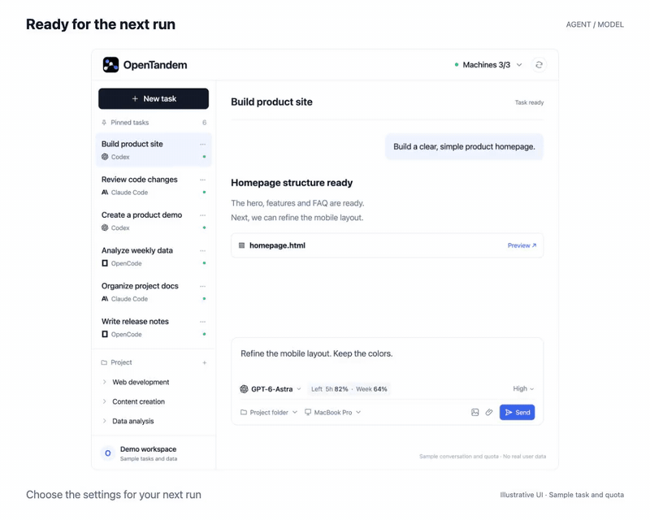
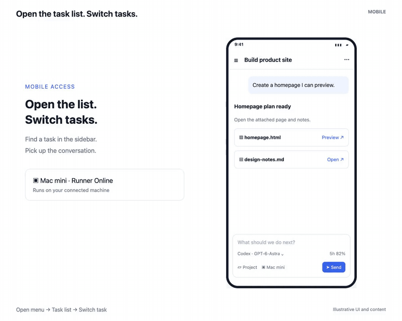
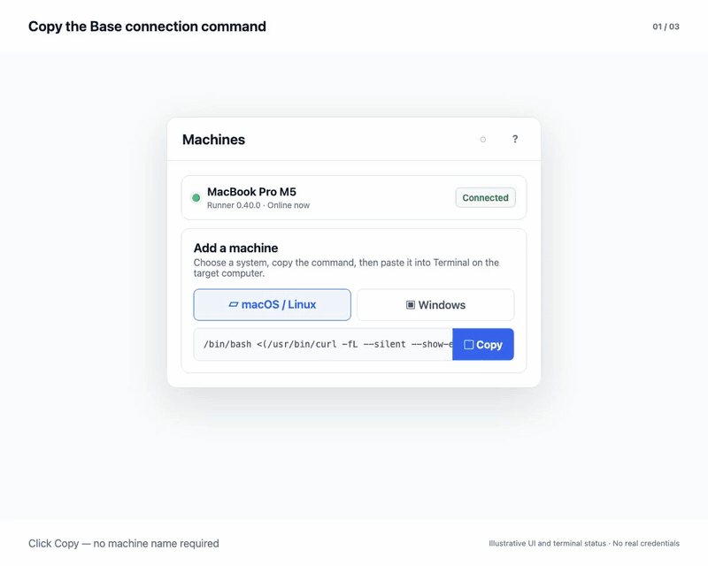
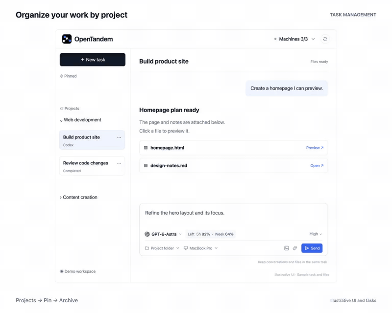
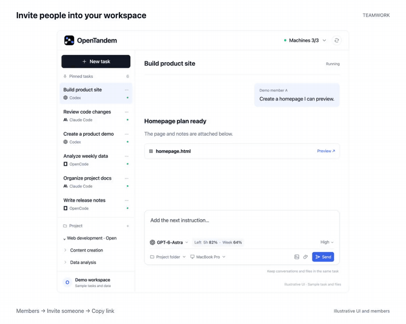
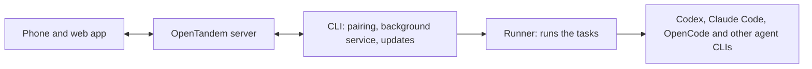

<div align="center">


<h1>OpenTandem</h1>

<p><b>English</b> | <a href="README.zh-CN.md">简体中文</a></p>

<p><b>OpenTandem is a unified workspace for individuals and teams that manages multiple AI coding agents, with mobile access.</b></p>

<p>One workspace, all your machines, with agent switching, model routing, live quota tracking, and team collaboration.</p>

<p>
<a href="https://opentandem.org?utm_source=github&utm_medium=readme&utm_campaign=opentandem_oss&utm_content=header_website">Website</a> · <a href="https://opentandem.org/download?utm_source=github&utm_medium=readme&utm_campaign=opentandem_oss&utm_content=header_download">Download</a> · <a href="https://opentandem.org/changelog?utm_source=github&utm_medium=readme&utm_campaign=opentandem_oss&utm_content=header_changelog">Changelog</a> · <a href="https://github.com/opentandem/opentandem/issues">Bug reports</a> · <a href="LICENSE">AGPL-3.0 License</a>
</p>

</div>

<p align="center"></p>

<h3 align="center">Run one command, scan with your phone, and keep coding from anywhere.</h3>

```sh
npx opentandem@latest remote
```

## Quick start

**1. Run this on the computer where your coding agents live.** It can be your laptop, a Mac mini
under the desk, or a Linux server you reach over SSH.

```sh
npx opentandem@latest remote
```

No Node.js on that computer? Use the installer instead:

```sh
# macOS and Linux
curl -fsSL https://opentandem.org/install.sh -o install.sh
sh install.sh remote
```

```powershell
# Windows PowerShell
irm https://opentandem.org/install.ps1 | iex; opentandem remote
```

**2. Scan the QR code with your phone.** Sign in with your email and tap **Allow** to connect this computer.

```text
$ npx opentandem@latest remote

  OpenTandem
  Scan with your phone to sign in and allow this computer:

  █▀▀▀▀▀█ ▄▀▄█ █▀▀▀▀▀█
  █ ███ █ ▀▄▀▄ █ ███ █
  …
  https://opentandem.org/agent-pair/7Kp2Xq

  Waiting for your phone… (valid for 10 minutes)
  ✓ Connected to "My workspace" as MacBook-Pro
  ✓ Runs in the background and starts with your computer
```

**3. Send a task from your phone.** Open OpenTandem, pick this computer, a project folder and an
agent, and send. The agent runs on your computer; you follow its progress and open its files on the phone.

Every run updates OpenTandem to the latest version first, so there is nothing else to keep up to date.

## What you get

OpenTandem starts the agent CLIs already installed on your computer, signed in with your own accounts,
inside your own project folders: Codex, Claude Code, OpenCode, Gemini CLI, GitHub Copilot CLI,
Cursor Agent CLI, Kimi Code, Qwen Code, Kiro CLI and more.

### Choose the right agent for the next run.

<sub>Agent and model switching</sub>

Switch between supported agents and their available models from the task composer, as shown above.
The task keeps its conversation and outputs.

- Switch agents and models in one place
- Models reported by the connected Runner
- Live quota visible beside each agent

### Move to your phone and keep working on the same task.

<sub>Mobile and artifacts</sub>

Mobile gives you the same task controls as desktop: continue the conversation, switch agents, track execution, and open generated images, documents, and HTML pages.

- Keep the same task and context
- Switch agents and models
- Track progress and open outputs

<p align="center"></p>

### Know which machine is ready before you assign the task.

<sub>Multi-machine orchestration</sub>

OpenTandem shows connected Runners and their live status. Send work to the machine that already has the right repository, tools, and environment.

- Runner availability in real time
- Project environment stays on the selected machine
- One workspace tracks every execution

<p align="center"></p>

### Manage tasks, conversations, and outputs in one place.

<sub>Task management</sub>

Organize work by project, keep conversations saved and archived, pin important tasks for follow-up, and open generated work from any device.

- Organize tasks by project
- Save, archive, and pin conversations
- Preview task outputs across devices

<p align="center"></p>

### Share tasks, execution progress, and finished work.

<sub>Team collaboration</sub>

Projects and tasks live inside a workspace with team access. Other members can continue the same execution without rebuilding its context in another conversation.

- Workspace and member management
- Shared projects and task progress
- Conversations and finished work in one place

<p align="center"></p>

More on the [website](https://opentandem.org/?utm_source=github&utm_medium=readme&utm_campaign=opentandem_oss&utm_content=features_more#capabilities).

## Commands

| Command | What it does |
|---|---|
| `opentandem remote` | Connect this computer by scanning a QR code with your phone. When it is already connected, it says so and shows a QR code that opens OpenTandem on your phone. |
| `opentandem list` | The Runners on this computer (one per workspace), their ids, and whether each is online. |
| `opentandem stop` · `start` · `restart` `[<id> \| all]` | Stop, start or restart one Runner by id (the first few characters are enough). With a single Runner the id can be left out; with several, it lists them and asks. `all` acts on the whole background service: `start all` also turns on start at login, `stop all` turns it off. |
| `opentandem logs [<id>] [-f]` | Show the latest log lines, or follow them. |
| `opentandem update` | Update the CLI and the Runner now and restart the service. |
| `opentandem uninstall` | Remove the service and the program. Your local conversation history stays. |

## Other ways to connect

| Way | When to use it |
|---|---|
| [Desktop app for Mac](https://opentandem.org/download?utm_source=github&utm_medium=readme&utm_campaign=opentandem_oss&utm_content=other_ways_download) | You prefer a window over the terminal. Sign in and choose **Connect**. |
| **Settings → Computers → Add a computer** in the [web app](https://opentandem.org/app?utm_source=github&utm_medium=readme&utm_campaign=opentandem_oss&utm_content=other_ways_webapp) | You are already signed in on the web and want to copy a command for another computer. |

> **Note for AI agents:** you may run `npx opentandem@latest remote` for the person you are helping,
> but only they can scan the QR code, sign in and allow the computer. Show them the QR code or the
> link and wait. Never try to complete the sign-in yourself.

## How OpenTandem fits together



| Part | What it is | Source |
|---|---|---|
| **[CLI](cli/)** | The `opentandem` command: connects the computer, keeps the Runner running in the background, starts it with the computer and keeps everything up to date. | Open source, AGPL-3.0 |
| **[Runner](runner/)** | Runs your tasks: starts the agent you chose in your project folder and streams its progress, answers and files back. | Open source, AGPL-3.0 |
| Web app and server | The workspace at [opentandem.org](https://opentandem.org?utm_source=github&utm_medium=readme&utm_campaign=opentandem_oss&utm_content=parts_table): tasks, conversations, machines, teams and mobile access. | Hosted service |

## Contributing

Bug reports and feature requests are welcome as [GitHub issues](https://github.com/opentandem/opentandem/issues).
We are not accepting pull requests yet, until a contributor license agreement is in place.
Please report security problems privately through
[GitHub security advisories](https://github.com/opentandem/opentandem/security/advisories/new) instead of a public issue.

## License

The CLI and the Runner are licensed under the [GNU Affero General Public License v3.0](LICENSE).
