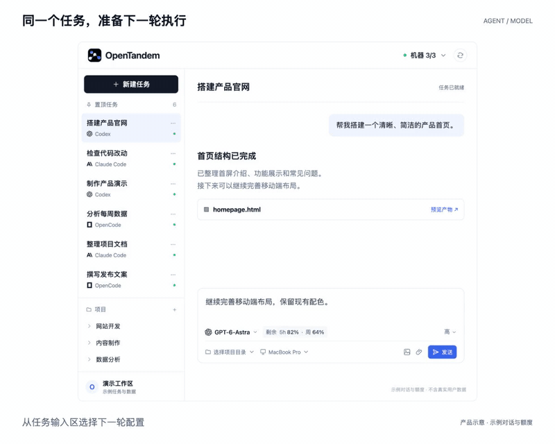
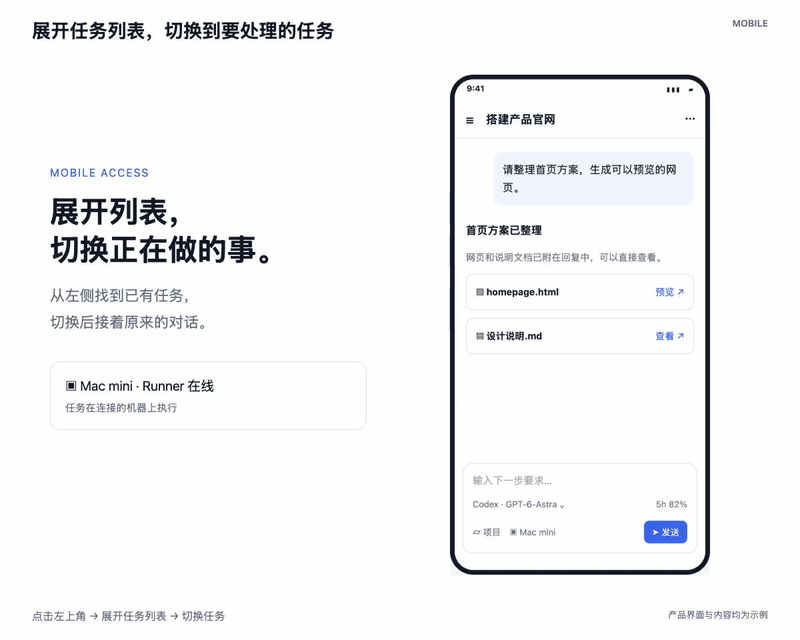
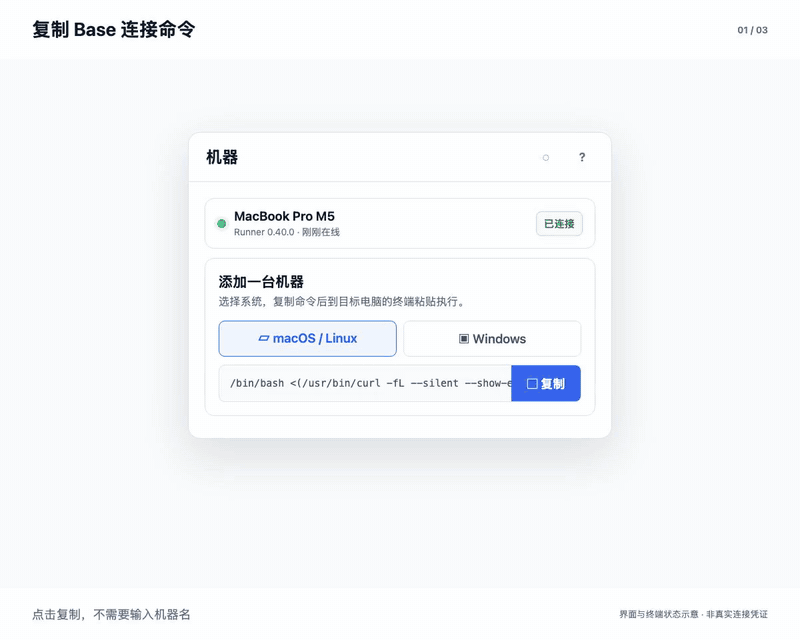
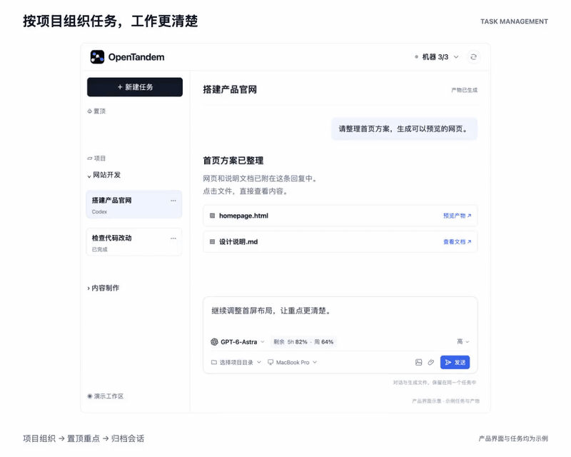
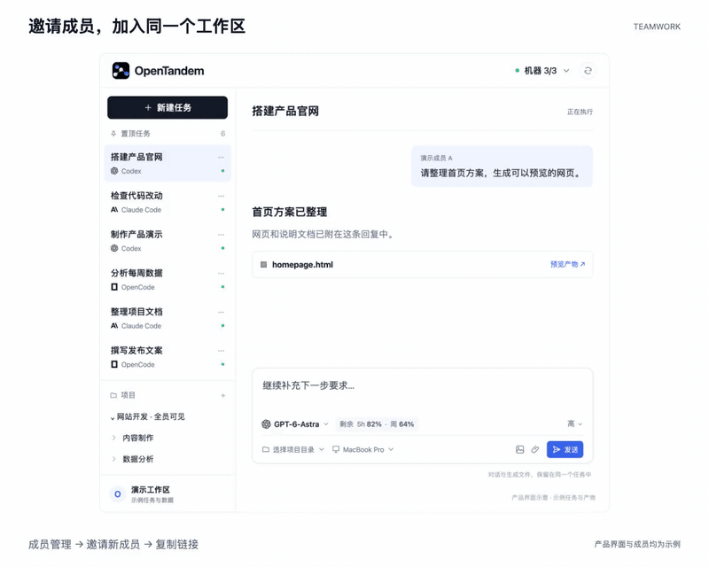
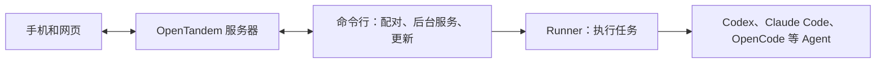

<div align="center">


<h1>OpenTandem</h1>

<p><a href="README.md">English</a> | <b>简体中文</b></p>

<p><b>OpenTandem 是一款面向个人与团队、统一管理多个 AI 编码 Agent，并提供移动端接入的工具。</b></p>

<p>一个空间，连接你的所有机器，支持 Agent 切换、模型调度、实时额度追踪与团队协作。</p>

<p>
<a href="https://opentandem.org/zh?utm_source=github&utm_medium=readme&utm_campaign=opentandem_oss&utm_content=header_website">官网</a> · <a href="https://opentandem.org/zh/download?utm_source=github&utm_medium=readme&utm_campaign=opentandem_oss&utm_content=header_download">下载</a> · <a href="https://opentandem.org/zh/changelog?utm_source=github&utm_medium=readme&utm_campaign=opentandem_oss&utm_content=header_changelog">更新日志</a> · <a href="https://github.com/opentandem/opentandem/issues">问题反馈</a> · <a href="LICENSE">AGPL-3.0 许可证</a>
</p>

</div>

<p align="center"></p>

<h3 align="center">在电脑上运行一条命令，用手机扫码，之后在哪里都能继续写代码。</h3>

```sh
npx opentandem@latest remote
```

## 快速开始

**1. 在装着编码 Agent 的那台电脑上运行下面的命令。** 可以是你的笔记本、放在桌下的 Mac mini，
也可以是你通过 SSH 登录的 Linux 服务器。

```sh
npx opentandem@latest remote
```

那台电脑没有装 Node.js 的话，改用安装脚本：

```sh
# macOS 和 Linux
curl -fsSL https://opentandem.org/install.sh -o install.sh
sh install.sh remote
```

```powershell
# Windows PowerShell
irm https://opentandem.org/install.ps1 | iex; opentandem remote
```

**2. 用手机扫描终端里的二维码。** 用邮箱登录后点 **允许**，这台电脑就连上了。

```text
$ npx opentandem@latest remote

  OpenTandem
  用手机扫码，登录并允许这台电脑连接：

  █▀▀▀▀▀█ ▄▀▄█ █▀▀▀▀▀█
  █ ███ █ ▀▄▀▄ █ ███ █
  …
  https://opentandem.org/agent-pair/7Kp2Xq

  正在等待手机确认…（10 分钟内有效）
  ✓ 已连接到「我的空间」，这台电脑叫 MacBook-Pro
  ✓ 已在后台运行，开机后会自动启动
```

**3. 在手机上发任务。** 打开 OpenTandem，选这台电脑、项目文件夹和 Agent，然后发送。Agent 在你的电脑上运行，
你在手机上看它的进度，打开它生成的文件。

每次运行都会先把 OpenTandem 更新到最新版本，不需要你另外维护。

## 你能得到什么

OpenTandem 启动的是你电脑上已经装好、用你自己账号登录的 Agent，在你自己的项目文件夹里运行：Codex、Claude Code、
OpenCode、Gemini CLI、GitHub Copilot CLI、Cursor Agent CLI、Kimi Code、Qwen Code、Kiro CLI 等等。

### 换 Agent、换模型，任务接着跑。

<sub>切换 Agent 与模型</sub>

同一个任务里随时切换已支持的 Agent 和模型（见上方动图），原有对话和产物都保留，不用从头再来。

- 随时切换 Agent 和模型
- 模型清单来自你连接的 Runner
- 每个 Agent 旁直接显示实时额度

### 换到手机，任务接着做。

<sub>手机端与产物</sub>

电脑上没跑完的，手机上继续：接着对话、看执行进度、直接打开生成的图片、文档和页面。

- 任务和上下文原样保留
- 手机上也能切换 Agent 和模型
- 进度、产物随时查看

<p align="center"></p>

### 派任务前，先看哪台机器就绪。

<sub>多机调度</sub>

已连接的 Runner 实时显示在线状态，任务交给代码仓库、工具、环境都备好的那台机器。

- 实时查看 Runner 在线状态
- 项目环境保留在各自机器上
- 一个空间跟进所有机器

<p align="center"></p>

### 任务、对话、产物，都在一个地方。

<sub>任务管理</sub>

按项目组织任务，会话统一保存归档；重要任务置顶跟进，产物在任何设备上都能打开。

- 按项目组织和管理任务
- 任务置顶、会话归档
- 跨设备预览任务产物

<p align="center"></p>

### 同事直接接手，不用重新交代。

<sub>团队协作</sub>

项目和任务放在团队空间里，其他人可以直接接续同一次执行，上下文原样都在。

- 空间和成员管理
- 共享项目与任务进度
- 对话和产物集中保存

<p align="center"></p>

更多介绍见[官网](https://opentandem.org/zh?utm_source=github&utm_medium=readme&utm_campaign=opentandem_oss&utm_content=features_more#capabilities)。

## 常用命令

| 命令 | 作用 |
|---|---|
| `opentandem remote` | 用手机扫码连接这台电脑。已经连接过时，会说明不需要再扫码，并给出一个在手机上打开 OpenTandem 的二维码。 |
| `opentandem list` | 列出这台电脑上的 Runner（每个空间一个）、它们的编号，以及是否在线。 |
| `opentandem stop` · `start` · `restart` `[<编号> \| all]` | 按编号停止、启动或重启一个 Runner，输入编号的前几位就够了。只有一个 Runner 时可以不写编号；有多个时会先列出编号让你选。`all` 操作整个后台服务：`start all` 同时打开开机自启，`stop all` 同时关闭。 |
| `opentandem logs [<编号>] [-f]` | 查看最近的日志，加 `-f` 持续查看。 |
| `opentandem update` | 立即更新命令行和 Runner，并重启后台服务。 |
| `opentandem uninstall` | 卸载后台服务和程序，本机的对话记录会保留。 |

## 其他连接方式

| 方式 | 适合什么情况 |
|---|---|
| [Mac 客户端](https://opentandem.org/zh/download?utm_source=github&utm_medium=readme&utm_campaign=opentandem_oss&utm_content=other_ways_download) | 你更习惯用窗口而不是终端。登录后点 **连接** 即可。 |
| [网页](https://opentandem.org/app?locale=zh&utm_source=github&utm_medium=readme&utm_campaign=opentandem_oss&utm_content=other_ways_webapp)里的 **设置 → 电脑 → 添加电脑** | 你已经在网页上登录，想复制一条命令到另一台电脑上运行。 |

> **给 AI Agent 的说明：** 你可以替用户运行 `npx opentandem@latest remote`，但扫码、登录和允许连接只能由用户本人完成。
> 请把二维码或链接给用户，然后等待，不要尝试自己完成登录。

## 整体结构



| 部分 | 是什么 | 源码 |
|---|---|---|
| **[命令行](cli/)** | `opentandem` 命令：连接这台电脑，让 Runner 在后台运行、随电脑启动，并保持所有组件为最新版本。 | 开源，AGPL-3.0 |
| **[Runner](runner/)** | 执行你的任务：在你的项目文件夹里启动你选的 Agent，把进度、回复和文件传回来。 | 开源，AGPL-3.0 |
| 网页和服务器 | [opentandem.org](https://opentandem.org/zh?utm_source=github&utm_medium=readme&utm_campaign=opentandem_oss&utm_content=parts_table) 上的空间：任务、对话、电脑、团队和手机访问。 | 托管服务 |

## 参与贡献

欢迎通过 [GitHub issues](https://github.com/opentandem/opentandem/issues) 报告问题和提出功能建议。
在贡献者许可协议准备好之前，我们暂时不接受 pull request。
安全问题请通过 [GitHub 安全公告](https://github.com/opentandem/opentandem/security/advisories/new) 私下报告，不要发公开 issue。

## 许可证

命令行和 Runner 以 [GNU Affero 通用公共许可证 v3.0](LICENSE) 发布。
